<div align="center">



### A Minecraft-style voxel sandbox, written from scratch in C++ and classic OpenGL

**Developed by Md Rejaul Korim Sadi** · ID 231-115-349 · CSE 58th Batch, Section I<br>
CSE 402 Computer Graphics & Image Processing Lab · Metropolitan University, Sylhet


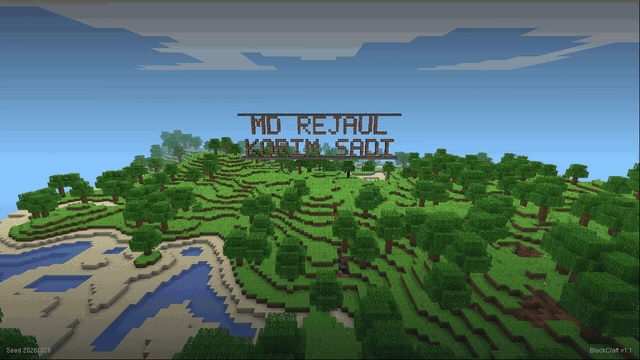

</div>

<br>

Every time BlockCraft starts it grows a new world of 192 × 192 × 64 blocks: grassy hills, beaches, lakes, oak trees, flowers, and under all of it a layer of stone full of caves and ore. You walk through it in first person, dig, build, swim, fly, and watch the sky go from day to sunset to a starry night.

There are no image files and no model files anywhere in this repository's source. All 21 textures are painted pixel by pixel when the program starts, and every cube is built from plain `glVertex3f` calls.

The program you read first is **`src/main.cpp`, exactly 100 lines**: the window, the OpenGL settings, the camera, the draw order of a frame, the game loop and the input. Everything else lives in **`lib/`** as a small engine that `main.cpp` calls into.

<div align="center">

| Walk to the name sign, then take off | Dig and build |
|:---:|:---:|
| 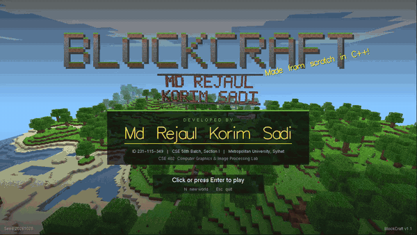 | 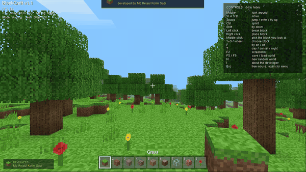 |
| **Day, sunset, night** | **Caves and ore underground** |
| 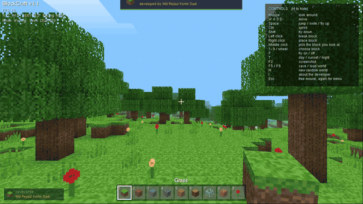 | 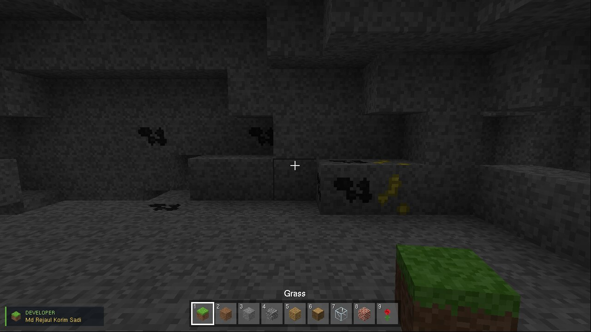 |

</div>

## What's inside

**World**
- Fractal value-noise terrain, a different world for every seed and the same world every time for one seed
- Spaghetti caves carved where two 3D noise fields meet, plus larger cave rooms
- Coal, iron, gold and diamond ore at realistic depths (diamonds only near the bottom)
- Oak trees, tall grass, roses and dandelions
- 19 block types, including see-through glass, leaves and water

**Graphics**
- Procedural 16 × 16 pixel-art texture atlas, sampled with `GL_NEAREST` for the crisp blocky look
- Smooth ambient occlusion at block corners, the technique Minecraft popularised
- Caves get darker the deeper they are below the surface
- Animated water, updated a few times a second with `glTexSubImage2D`
- Chunked rendering: 144 display lists, only faces next to air are drawn, only edited chunks rebuild
- Distance fog, underwater fog, a sun and moon, twinkling stars, drifting clouds

**Play**
- First-person camera with mouse look, walking bob and a wider field of view when you sprint
- Gravity, jumping, swimming, fly mode and box collision against the world
- Break with left click (with flying block particles), place with right click, pick a block with middle click
- The held block shows in your hand and swings when you use it
- Nine-slot hotbar, debug info, controls panel
- Save and load the world, and save screenshots as BMP files

**Credits on screen**
- A giant **MD REJAUL KORIM SADI** sign built out of brick blocks in every world, standing in front of the start point and framed on the title screen
- An animated title screen with the developer card
- A "developed by" popup when the game starts
- A developer badge that stays in the corner the whole time, and the full card again on the `I` key

<div align="center">
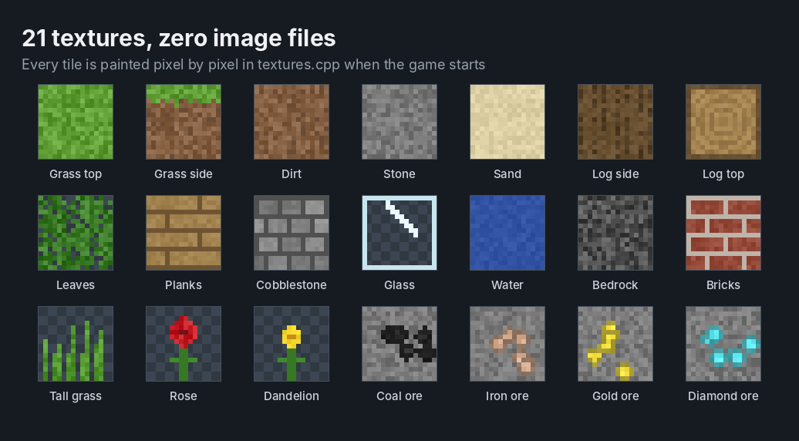
</div>

## Gallery

<div align="center">

| | |
|:---:|:---:|
| 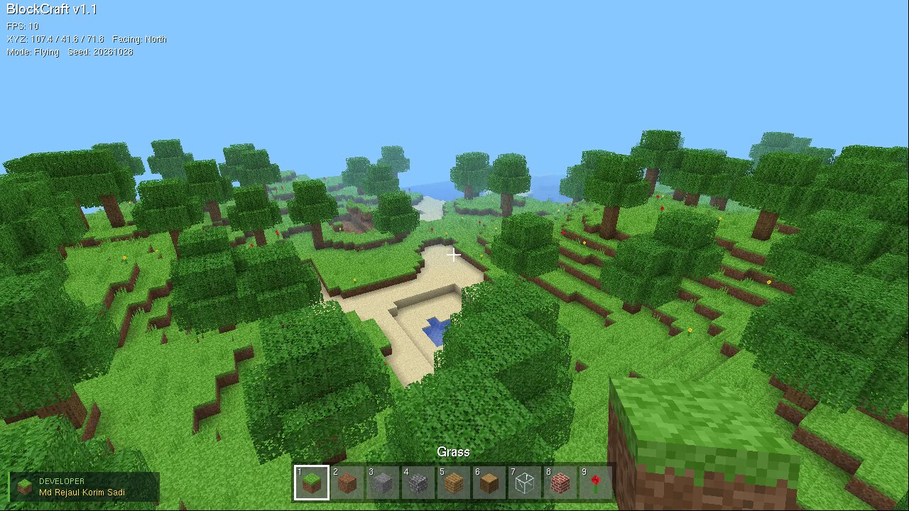 | 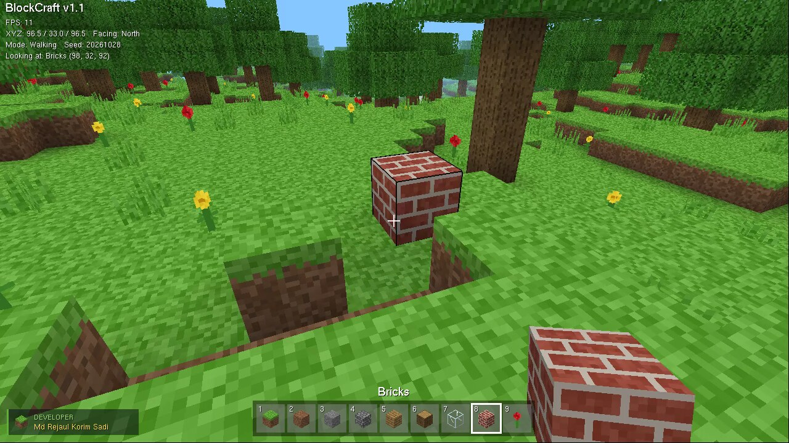 |
| Flying over the hills | Building next to an oak |
| 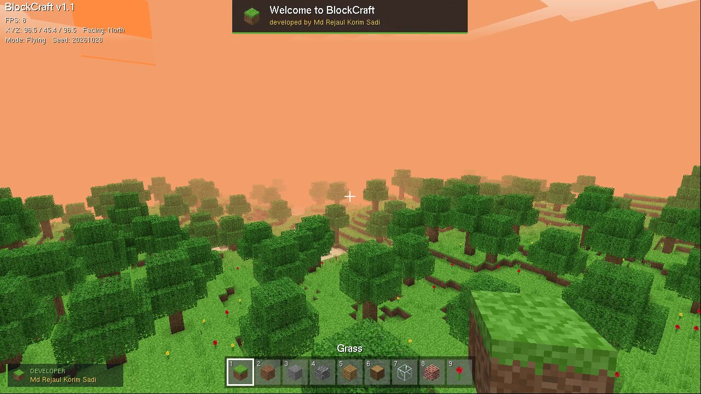 | 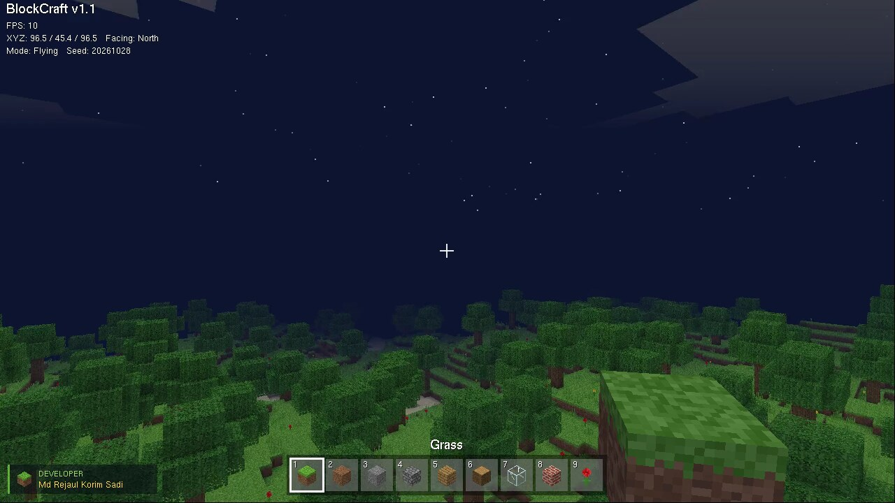 |
| Sunset, the fog takes the sky's colour | Night, with stars |
| 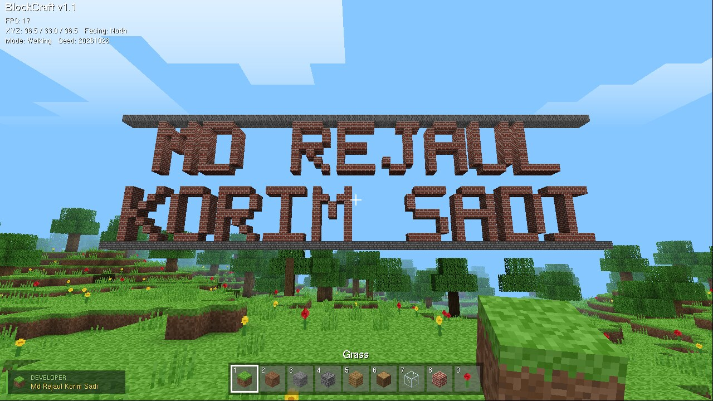 |  |
| The name sign, built from blocks | Under the ground |

</div>

## The code in two layers

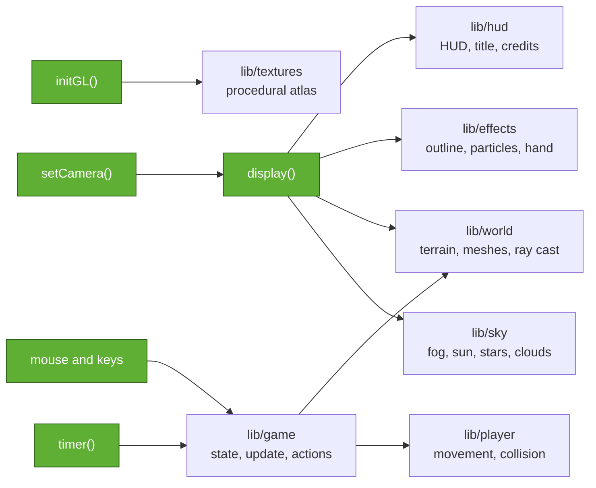

Green boxes are the functions in `src/main.cpp`; the rest are files in `lib/`.

This is the whole frame, straight from `main.cpp`:

```cpp
void display() {
    clearSky();                                          // clear colour and depth buffers
    setCamera();
    drawSky();
    glEnable(GL_TEXTURE_2D);                             // solid blocks, with texture and alpha test
    glBindTexture(GL_TEXTURE_2D, game.atlas);
    glEnable(GL_ALPHA_TEST);
    game.world->drawOpaque(game.view.x, game.view.z);
    glDisable(GL_ALPHA_TEST);
    RayHit hit = lookAt();                               // the block under the crosshair
    if (game.screen == PLAYING) { drawSelection(hit); drawParticles(); }
    drawClouds();
    glEnable(GL_TEXTURE_2D);                             // water last, blended with what is behind it
    glEnable(GL_BLEND);
    glDepthMask(GL_FALSE);
    game.world->drawWater(game.view.x, game.view.z);
    glDepthMask(GL_TRUE);
    glDisable(GL_BLEND);
    drawOverlay(hit);                                    // 2D layer: HUD, or the title screen
    glutSwapBuffers();                                   // double buffering: show the finished frame
}```

## Controls

| Key | Action | | Key | Action |
|---|---|---|---|---|
| Mouse | Look around | | F | Fly on / off |
| W A S D | Move | | T | Day, sunset, night |
| Space | Jump, swim up, fly up | | F2 | Save a screenshot |
| Ctrl | Sprint | | F3 | Debug info |
| Shift | Fly down | | F5 / F9 | Save / load world |
| Left click | Break block | | N | New random world |
| Right click | Place block | | H or F1 | Controls panel |
| Middle click | Pick the block you look at | | I | About the developer |
| 1 to 9, wheel | Choose block | | Esc | Free mouse, again for the menu |

## Running it

### Windows with Code::Blocks

1. Download the repository as a ZIP (green **Code** button, then **Download ZIP**) and unzip it.
2. Double-click **`open_in_codeblocks.bat`** inside the folder.
3. When Code::Blocks opens, press **F9**.

The freeglut headers and import library are already in the repository under `deps\`, so the project always compiles. The only thing the game needs at run time is `libfreeglut.dll`. The first time, the script installs Code::Blocks (with its MinGW compiler) and the freeglut package through `winget`, which takes a few minutes. After every build, Code::Blocks copies the DLL into `bin\` by itself. Nothing is copied into Program Files.

If Code::Blocks asks which compiler to use, pick **GNU GCC Compiler**. To run the world tests, switch the target drop-down from **Release** to **Tests** and press F9 again.

<details>
<summary>Setting it up by hand instead</summary>

1. Install Code::Blocks with MinGW (`codeblocks-25.03mingw-setup.exe` from codeblocks.org).
2. Install the freeglut DLL: install MSYS2, then run `pacman -S mingw-w64-ucrt-x86_64-freeglut`.
3. Open `BlockCraft.cbp` and press F9. The build copies `C:\msys64\ucrt64\bin\libfreeglut.dll` into `bin\`.

| Problem | Fix |
|---|---|
| `GL/freeglut.h: No such file or directory` | the `deps` folder is missing; unzip the whole repository again |
| "libfreeglut.dll was not found" when the game starts | install the freeglut package (step 2), or copy `libfreeglut.dll` into `bin` |
| "Can't find compiler executable" | install the Code::Blocks version with "mingw" in its name |

</details>

### Linux

```bash
sudo apt install g++ make freeglut3-dev
make run        # build and play
make test       # run the world tests
```

or with CMake: `cmake -S . -B build && cmake --build build && ctest --test-dir build`

## Reproducibility

The same seed always gives the same world, block for block. The default seed is `20261028`, and you can pass another one when starting: `blockcraft 12345` (the seed shows on the title screen and in the F3 info).

`tests/world_test.cpp` checks this without opening a window. It builds the world twice and compares a fingerprint of all 2.3 million blocks, then checks the terrain, ores, caves, lighting, ray casting, and that a saved world loads back exactly.

```
BlockCraft world tests (seed 20261028)
  world fingerprint: E8616371
  [PASS] the same seed builds the same world twice
  ...
  reference fingerprint E8616371: matches
all checks passed
```

The reference fingerprint was taken with GCC 13.3 on x86-64. A different compiler can round a float differently and produce a slightly different world. If that happens the test says so but doesn't fail.

Everything in `docs/media` was recorded from the game itself with seed `20261028` at 1280 × 720. On Linux, `tools/record.sh` does the same thing again: it starts the game on a virtual screen, replays a list of key presses and mouse moves, and saves the clip as a GIF (it needs Xvfb, xdotool and ffmpeg).

## How it works

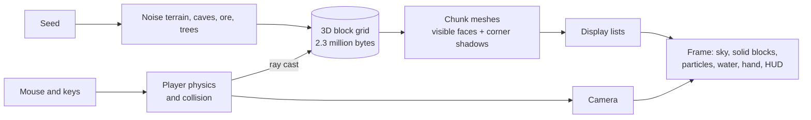

| Graphics idea | Where to find it |
|---|---|
| Perspective projection | `gluPerspective` in `setCamera()`, `src/main.cpp` |
| Viewing transform | `glRotatef` and `glTranslatef` by the negative eye position, `setCamera()` |
| Orthographic 2D overlay | `gluOrtho2D` in `ortho()`, `lib/hud.cpp` |
| Texture mapping, atlas UVs | `buildAtlas()`, `tileUV()` in `lib/textures.cpp` |
| Texture animation | `animateWater()` with `glTexSubImage2D`, `lib/textures.cpp` |
| Hidden-surface removal | depth test and culling in `initGL()`, `faceVisible()` in `lib/world.cpp` |
| Ambient occlusion | `cornerAO()` in `lib/world.cpp` |
| Transparency | alpha test for leaves, glass and plants, blending for water, both in `display()` |
| Billboards | particles turned to face the camera in `drawParticles()`, `lib/effects.cpp` |
| Retained-mode geometry | one display list per chunk per pass, `lib/world.cpp` |
| Picking | `World::raycast()` voxel traversal, called from `mouseButton()` |
| Vector and bitmap text | `glutStrokeString` for titles, `glutBitmapString` for the HUD, `lib/hud.cpp` |

The full walkthrough, from "what is OpenGL" to every function in the project, is in **[docs/GUIDE.md](docs/GUIDE.md)**.

To find the code behind any shape on screen (a cube, the outline box, particles, the sun, the hotbar icons, the logo), see the **[code map](docs/CODE_MAP.md)**. It lists every shape with its OpenGL primitive, file and line.

## Project layout

```
BlockCraft/
├── src/
│   └── main.cpp              the 100 lines: window, OpenGL setup, camera, frame, loop, input
├── lib/                      the engine main.cpp calls into
│   ├── game.h / .cpp         shared state, world start, the name sign, per-frame update, key actions
│   ├── world.h / .cpp        block grid, terrain, caves, ore, meshes, lighting, ray cast, save/load
│   ├── player.h / .cpp       movement, gravity, swimming, collision
│   ├── textures.h / .cpp     procedural texture atlas and water animation
│   ├── sky.h / .cpp          sky colour, fog, sun, moon, stars, clouds
│   ├── effects.h / .cpp      block outline, break particles, the block in your hand
│   ├── hud.h / .cpp          HUD, title screen, developer credit, screenshots
│   ├── blocks.h              block types and their textures
│   └── noise.h               2D and 3D value noise
├── tests/world_test.cpp      reproducibility and world checks
├── tools/record.sh           re-records the GIFs from the game
├── docs/
│   ├── GUIDE.md              the complete guide
│   ├── CODE_MAP.md           which file and line draws each shape
│   └── media/                banner, GIFs and screenshots
├── deps/                     freeglut headers and import library for Windows builds
├── open_in_codeblocks.bat    one double-click to set up and open on Windows
├── BlockCraft.cbp            Code::Blocks project (Release and Tests targets)
├── CITATION.cff              how to cite this project
├── CMakeLists.txt
├── Makefile
└── LICENSE
```

## References

- John Amanatides and Andrew Woo, *A Fast Voxel Traversal Algorithm for Ray Tracing*, Eurographics 1987. Used for block picking.
- Mikola Lysenko, [*Ambient occlusion for Minecraft-like worlds*](https://0fps.net/2013/07/03/ambient-occlusion-for-minecraft-like-worlds/), 0fps.net, 2013. Used for the corner shadows and the quad-flip rule.
- [freeglut](https://freeglut.sourceforge.net/), for the window, input and fonts.

## Author

**Md Rejaul Korim Sadi**<br>
ID 231-115-349 · CSE 58th Batch, Section I · Department of Computer Science & Engineering, Metropolitan University, Sylhet

Course: CSE 402 Computer Graphics & Image Processing Lab. Course teacher: Shrabanti Chowdhury, Lecturer, Department of EEE.

BlockCraft is a student project inspired by Minecraft by Mojang Studios. It is not affiliated with or endorsed by Mojang or Microsoft and uses none of their code, textures or assets. Released under the MIT License.
